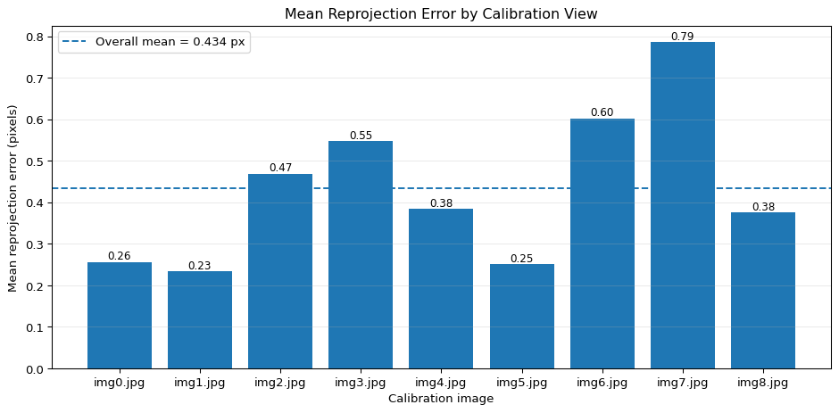
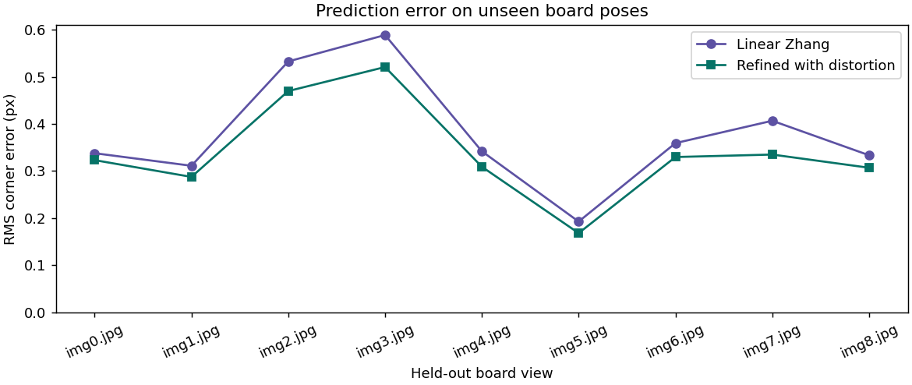
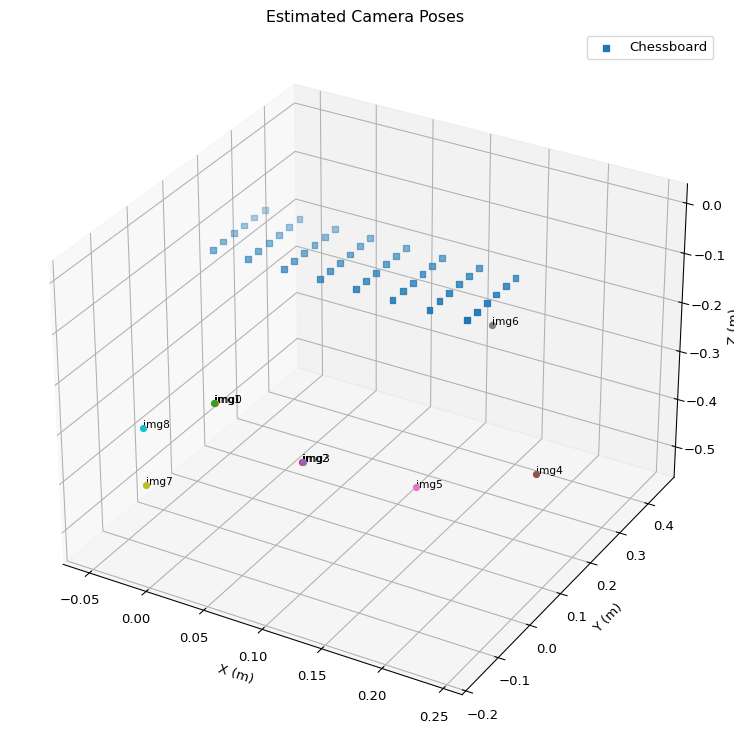

# Camera calibration for an industrial inspection station

**Denos Kume · MSc Control and Robotics · Centrale Nantes**

[Explore the portfolio case study](https://raw.githack.com/denoskume/msc-coro-dassip-portfolio/main/index.html#/projects/camera-calibration) · [Download the offline viewer](https://github.com/denoskume/camera-calibration/raw/refs/heads/main/review/index.html) · [Read the executed notebook](Camera_Calibration.ipynb)

## Mission

Before a fixed camera can locate features on a planar inspection fixture, an engineer needs to know how board coordinates map to image pixels. This Centrale Nantes MSc case study uses Zhang’s method to estimate the camera intrinsics and the pose of a chessboard in nine laboratory photographs. The inspection station provides the industrial context.

## Fit on the nine calibration views

| Measure | Result |
|---|---:|
| Chessboard views retained | 9 of 9 |
| Detected corners | 432 |
| Mean reprojection error | 0.434 px |
| Overall RMS reprojection error | 0.534 px |
| Highest view-level RMS error | 0.859 px on img7.jpg |

The board has 8 × 6 inner corners and a square pitch of 30 mm. The notebook refines their image locations, fits a normalized DLT homography per view, solves Zhang’s constraints for the common intrinsic matrix, and recovers nine board-to-camera poses. The review lets you toggle corner overlays on every source image. The exported files contain the [camera matrix and poses](outputs/calibration.json) and [per-view measurements](outputs/view_errors.csv).

## Predicting corners on a held-out view

Fit the camera on eight images. On the ninth, use 24 alternating corners to estimate the board pose and predict the other 24. Repeat for each view, yielding 216 test corners per model.

| Camera model | Pooled held-out RMS | Highest view RMS |
|---|---:|---:|
| Linear Zhang | 0.395 px | 0.589 px on img3.jpg |
| Nonlinear OpenCV with lens distortion | 0.352 px | 0.521 px on img3.jpg |

The refined model reduced the pooled error by 10.7% and improved all nine folds. It also changes the optimization and skew constraint, so the gain cannot be attributed solely to distortion correction. For an inspection station, this result supports testing the refined model on a dimensionally certified reference part across the working area. Production tolerances remain unverified.

[Download per-view test results](outputs/held_out_view_errors.csv) · [Run the browser calibration workspace](https://raw.githack.com/denoskume/msc-coro-dassip-portfolio/main/index.html#/workspace/calibration)

## Commissioning review

Open the HTML review, expand a photograph and toggle the corner overlay. Start with **img7.jpg** (0.859 px RMS), then compare it with **img1.jpg** (0.277 px RMS). Cyan circles mark measured corners and orange crosses mark model projections. Use the two views to examine how the same fitted camera behaves under different board poses.

Mark each view **Reviewed** or **Investigate** and record the reason. The viewer saves drafts in the current browser and exports all nine rows to CSV. For a separate review, use the [blank worksheet](review/reader_template.csv). The [run manifest](review/run_manifest.json) records the input hashes, target geometry, software versions and result hashes.

## Experience gained

- Used point normalization and singular value decomposition to estimate homographies from coordinates expressed in metres and pixels.
- Checked recovered rotations for orthogonality and unit determinant before using them to project the board.
- Used per-view residuals to identify the pose that warrants the closest inspection. The fitted pinhole model omits distortion. Qualifying it for dimensional inspection would require independent reference measurements and a part tolerance.

## Reproduce

Download the repository ZIP and extract it. From its root, install the dependencies in a Python 3.12 environment with `python -m pip install -r requirements.txt`. Open `Camera_Calibration.ipynb` in VS Code, select that environment, and run all cells. The notebook regenerates six diagnostic figures, the calibration parameters, the error table and the standalone HTML viewer.

[Original MSc lab and historical materials](https://github.com/denoskume/msc-coro-dassip-portfolio/tree/0698d843d50896879ec3aec2ebae7d5a170b76c0/computer-vision/camera-calibration)
